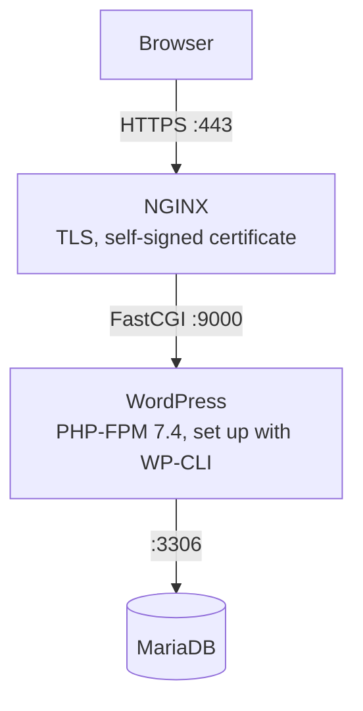

# Inception

A small web infrastructure built with Docker Compose, as part of the 42 curriculum. Each service runs in its own container, built from a custom Dockerfile on Debian Bullseye (no ready-made images).

## Architecture



- **NGINX** is the only entry point, exposed on port 443.
- **WordPress** and **MariaDB** are only reachable inside the `inception` bridge network.
- Two bind-mounted volumes keep the WordPress files and the database between restarts.
- Containers restart automatically (`restart: always`).
- All credentials come from environment variables. No password is written in the repository.

## Project structure

```
srcs/
├── docker-compose.yml
└── requirements/
    ├── nginx/      Dockerfile, NGINX configuration
    ├── wordpress/  Dockerfile, tools/auto_config.sh (WP-CLI setup)
    └── mariadb/    Dockerfile, conf/, tools/script.sh (database setup)
```

## Getting started

Requirements: Docker and Docker Compose.

1. Create the environment file from the template and fill in your own values:
   ```bash
   cp srcs/.env.example srcs/.env
   ```
2. Create the data folders used by the volumes, or change the `device` paths in `srcs/docker-compose.yml`:
   ```bash
   mkdir -p ~/data/wordpress ~/data/mariadb
   ```
3. Build and start the stack:
   ```bash
   make up
   ```
4. Open `https://<DOMAIN_NAME>` in your browser (accept the self-signed certificate).

| Command     | Action                                         |
|-------------|------------------------------------------------|
| `make up`   | Build the images and start the containers      |
| `make down` | Stop the containers and remove the images      |
| `make re`   | Clean everything and rebuild from scratch      |

## What I learned

- Writing Dockerfiles and orchestrating several services with Docker Compose
- Configuring NGINX with TLS as a reverse proxy to PHP-FPM
- Automating a WordPress installation with WP-CLI
- Isolating services in a Docker network and persisting data with volumes
- Keeping secrets out of the code with environment variables
